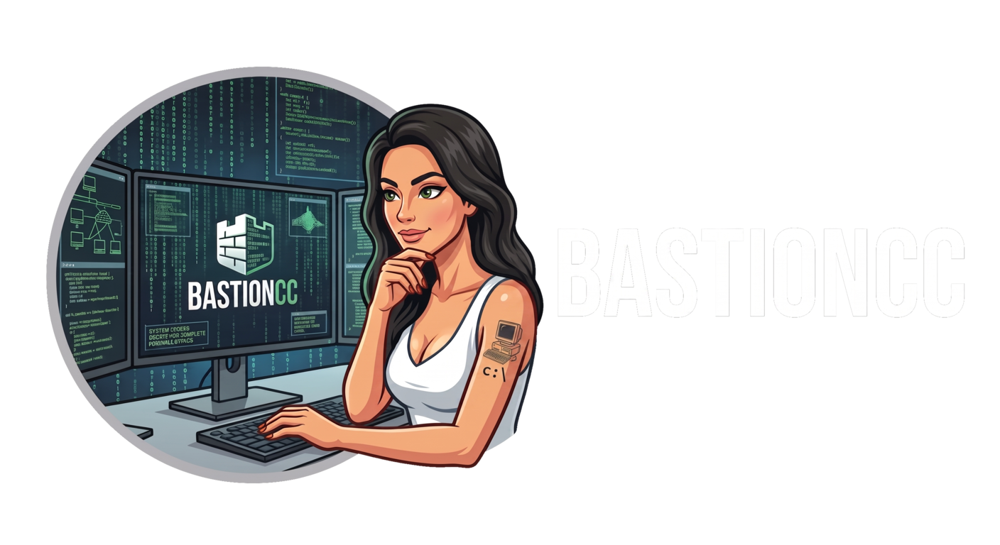
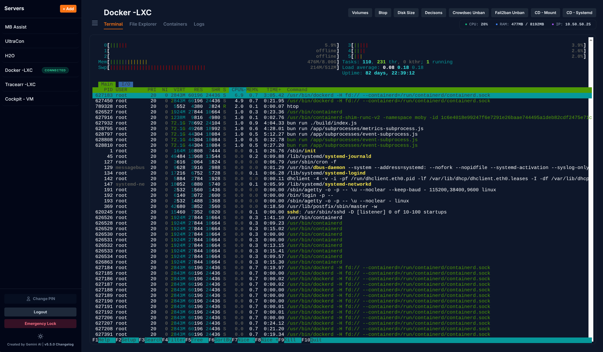
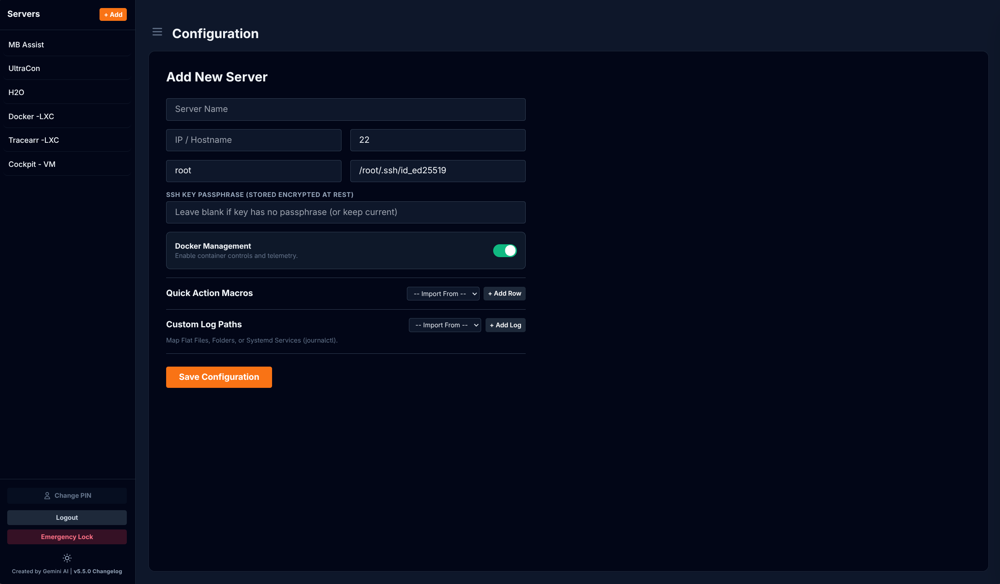
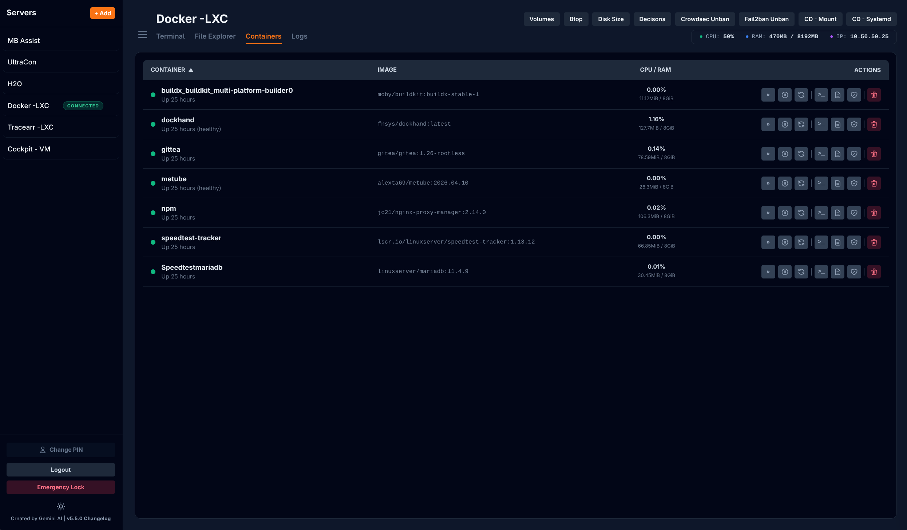
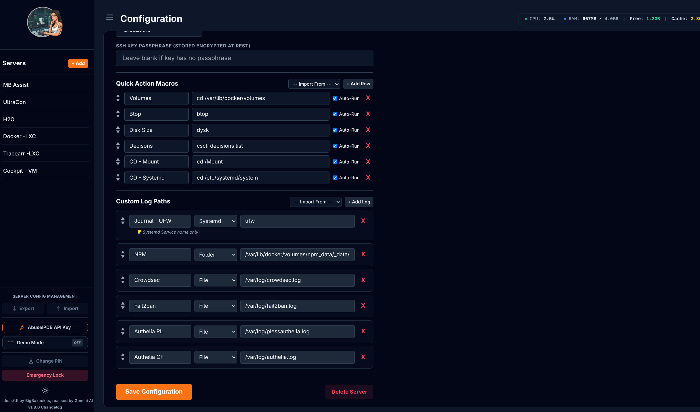
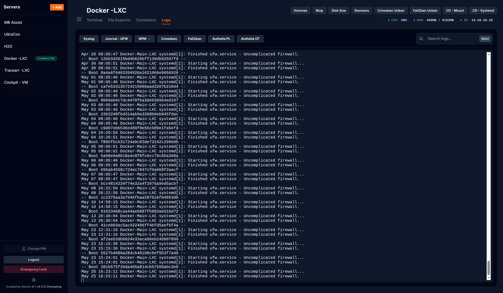
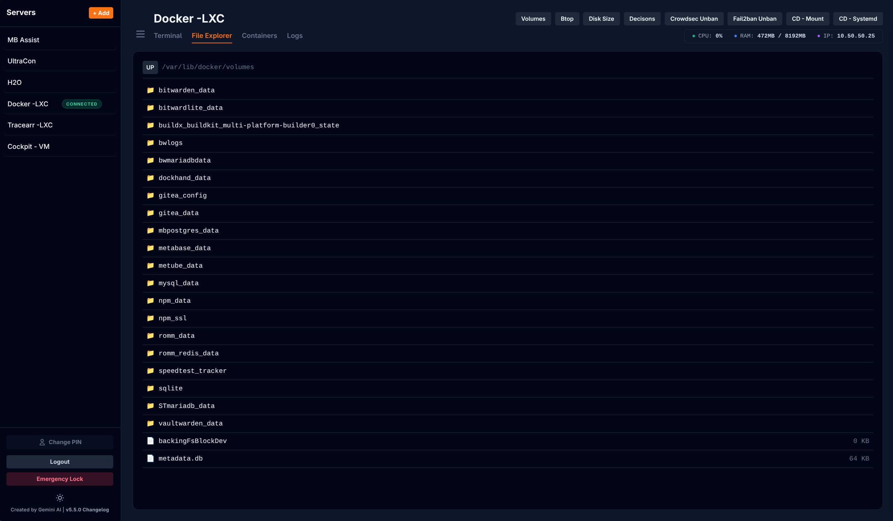
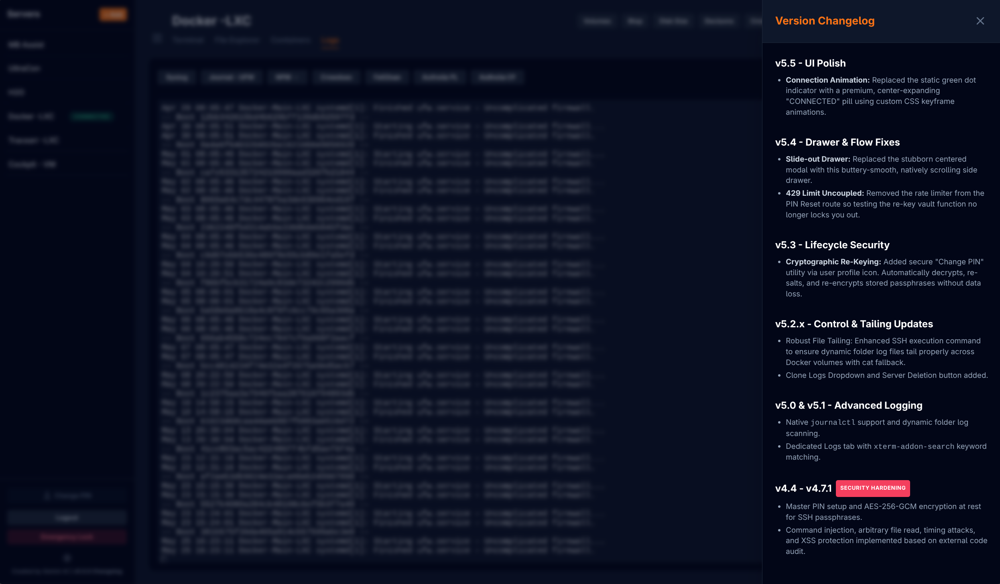

# Version .26 and above contain the node cve patches.

## If you do not like AI assisted code then please pass on by, we get it you don't think it's real code just like how my dad stated digital photography is not real photography and look how that turned out (;o)

### The tool is perfect if you manage many VM's, LXC, cloud compute etc and would like to consolidate them all into one "pane of glass" with lightweight yet powerful features built in.

### Full documentation can be found here > https://docs.bastioncc.cloud

## Features

### Add multiple servers via a simple user interface 
    * Add SSH Keys and authenticate in the backend once when adding the server (password is not stored in file and is hashed using your master password

 
 
### Xterm.js terminal

### Docker management per server (like portainer but simple and lightweight no plugin required)
  

  From V1.9.8.18-beta:
  
    - Basic tools such as start, stop, restart, exec, log viewer, image grype scan and delete container
    - Docker compose / stack editor and deployment tool
    - Single container editor
  ~~~
  From V1.9.8.32:
     - Check for Updated images
     - Check GCHR/Docker.io & Private repos
     - Click on tag to auto update tag field & Click update to confirm
   ~~~
      From V2.0:
     - Modal exec for containers, no longer switches to terminal tab
     - Set restart policy per container if needed injects into crontab
     - convert Docker run to Docker compose
   
  
### Create "Macros" i.e command shortcuts you may use often, these will appear above the xterm terminal window and import Macro templates from your other servers to save having to recreate
  
  
### Add logs you would like to monitor, these appear as buttons in the log viewer page and you can add 3 types:

    - Files (direct links to files)
    - Folders (system scans folder and displays the button as a drop down list to select)
    - Systemd / Journalctl (Enter the term you would like to isolate i.e UFW)
    - Clone preset logs to other servers

    
  
  
### Log viewer

  

  Includes the following security audits:

  - WHOIS Lookup
  - Threat Detection Score (Local or via AbuseIPDB)
  - Ban Actions (Single IP or /24) Via Crowdsec > Fail2ban > Firewall

Version 2.0+
  - Clean rotated logs in /var/log and user added paths
  - Checks security threats in logs and ignores those already banned.

  
### SFTP file management with drag and drop ability to transfer files.
    
 

Version 2.0+
  - Permissions Viewer and Editor
  - Multi Select (delete and download)
  - Modal file editor with script format highlighting (python, bash, json, yaml etc)

    
### Emergency lock out button for the paranoid aka me, click this and the system kills all sessions, removes pubkey salted hashes and logs you out.
### Dark and Light theme of course.
    

## Installation

**Pull the latest docker image**

~~~
Save the docker-compose.yml file to your preferred location. Double check the file points to the latest version shown in packages.
Docker Compose up
visit localhost:3000 or 127.0.0.1:3000
~~~
**Or download the latest installer for your OS**

## Security Approach

Code is created initially via Gemini pro models with security placed as ultimate priority for the persona.

I then parse the code via various models in my olama instance for quick find issues specific, the tweaks are rerun via gemini until the release is ready.

The complete scripts are then passed through Claude which highlights remaining vulnerabilities. Gemini implements the patches until Claude passes all issues as clean

The code is then updated on this Github and scanned upon saving. Any recommendations from CODEQL get passed back to Gemini to review.

Once the patches are applied the code is then parsed again through Claude and we repeat until no more issues are found by the models. Then:

### The code is here for all to see, I am no code or security expert and do not pretend to be, so cast your eye over the code and judge for yourself

